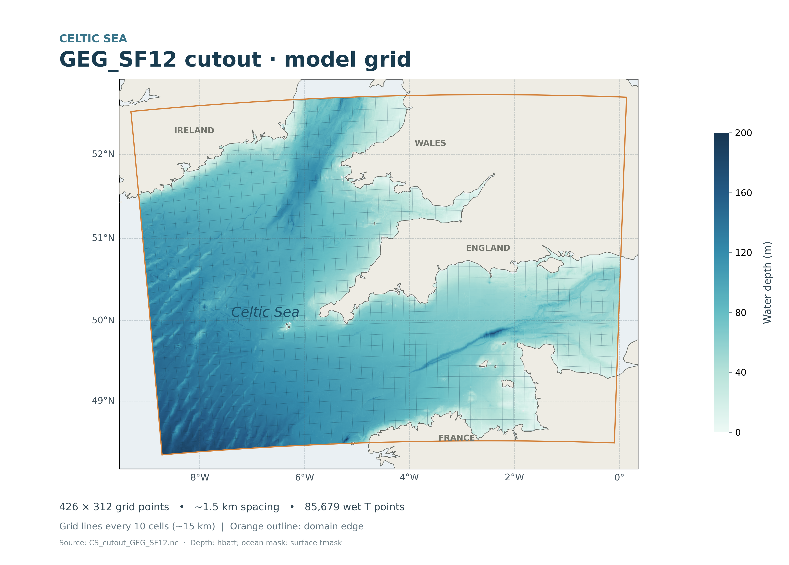

# CelticSea1.5

## Overview

This guide described the process of building a regional NEMO model covers the Celtic Sea. The setup is designed for the Cirrus HPC system (https://www.cirrus.ac.uk/), and the setup procedure is largely the same as that previously used on ARCHER2. The compilation workflow referenced a NEMO building script provided by Sarah Wakelin. Many forcing generation methods and scripts were provided by other modellers and will be acknowledged in the following description.

If you are using a different HPC system, you may need to adapt the compilation and execution procedures. Note that the same model configuration may produce slightly different outputs on different systems owing to differences in floating-point calculations, compilers, MPI libraries and process counts.

The [GitHub wiki](https://github.com/BinGuo999/CelticSea1.5/wiki) and the [documentation website](https://binguo999.github.io/CelticSea1.5/) explain each step of building and running the model.

## Model Summary

Celtic Sea 1.5 covers the Celtic Sea and surrounding shelf waters, from approximately 9.31°W to 0.14°E and 48.32°N to 52.70°N, as shown in the map below.

The model grid is a direct cutout of AMM15 with 1.5 km horizontal resolution but with 30 sigma vertical levels. Featuring:

- FES2014 tides
- Open boundary forcing downscaled from the AMM7 reanalysis
- ERA5 Surface forcing
- River forcing achieved from Glofas dataset
- Initial condition (with Temperature and salinity) from the AMM7 reanalysis
- Wetting and drying in shallow coastal areas

